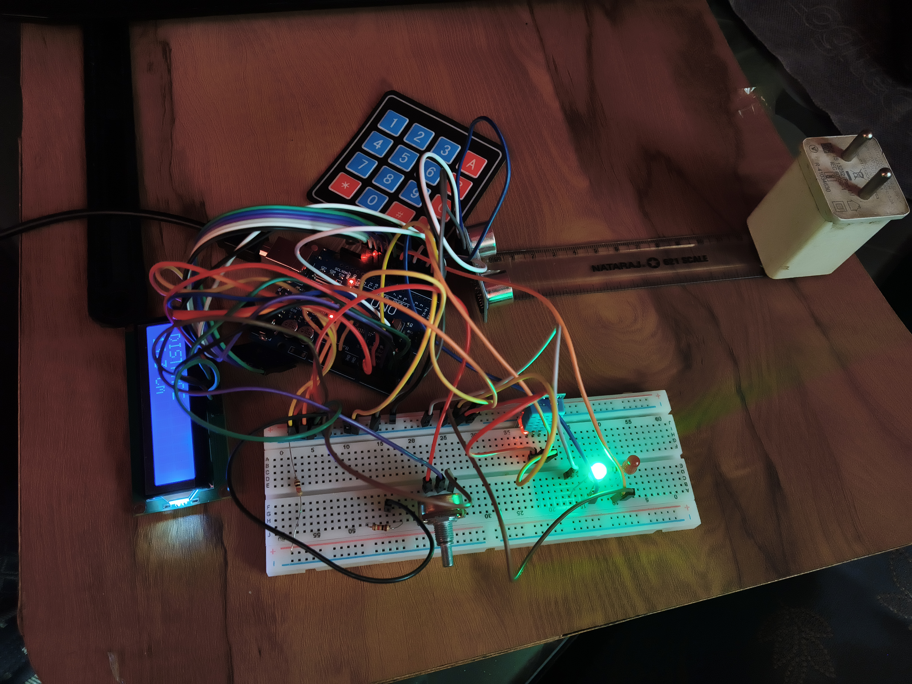
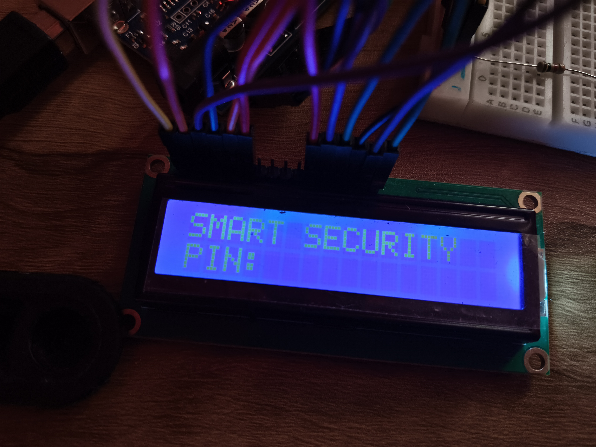
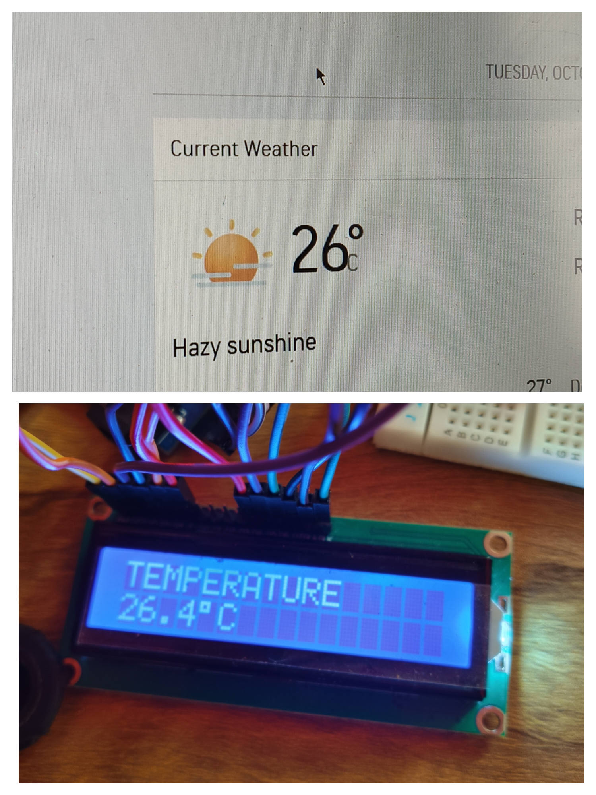
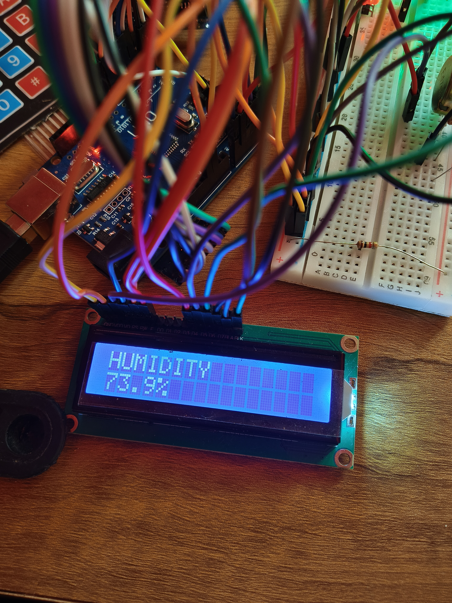
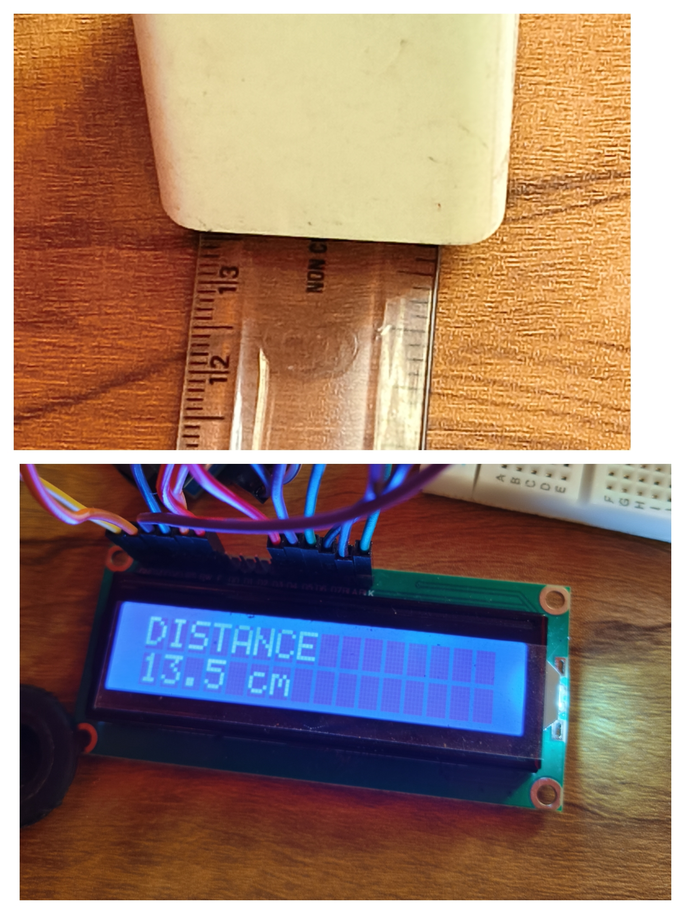

# Arduino-Smart-Security-Monitoring-System
Arduino-based security and environmental monitoring system with PIN authentication, temperature, humidity and distance monitoring

# Smart Security & Environmental Monitoring System 🔐🌡️

An Arduino-based security and environmental monitoring system combining PIN authentication, keypad input, LCD feedback, temperature and humidity monitoring, distance measurement, LEDs, and buzzer-based alerts.

## 🎥 Project Demo

[Watch the Project Functioning](6-explanation.mp4)

## 📌 Overview

This project is a small Arduino-based security and environmental monitoring system built using an Arduino Uno.

The system starts with a PIN-based authentication screen. The user enters a PIN using a 4×4 matrix keypad and presses the `2` key to submit it.

If the entered PIN is correct, the system grants access, turns on the green LED, and produces one short buzzer beep. After successful authentication, the system switches to monitoring mode and displays temperature, humidity, and distance readings on a 16×2 LCD.

The temperature and humidity are measured using a DHT11 sensor, while distance is measured using an HC-SR04 ultrasonic sensor.

If an incorrect PIN is entered, the red LED turns on and the buzzer sounds continuously for 3 seconds. After that, the system returns to the PIN entry screen.

The project was built through hands-on testing and troubleshooting of individual components before integrating everything into one working system.

## ✨ Features

- 🔐 PIN-based access control
- 🔢 4×4 matrix keypad input
- 🖥️ 16×2 LCD display
- 🌡️ Temperature monitoring using DHT11
- 💧 Humidity monitoring using DHT11
- 📏 Distance measurement using HC-SR04 ultrasonic sensor
- 🟢 Green LED for successful authentication
- 🔴 Red LED for failed authentication
- 🔊 Buzzer-based access feedback
- 📊 Automatic sensor display after successful login
- 🔒 Relocking using the `*` key
- ⚡ Arduino-based hardware and software integration

## 🔧 Components Used

| Component | Quantity |
|---|---:|
| Arduino Uno | 1 |
| 16×2 Parallel LCD | 1 |
| 4×4 Matrix Keypad | 1 |
| DHT11 Temperature & Humidity Sensor | 1 |
| HC-SR04 Ultrasonic Sensor | 1 |
| Green LED | 1 |
| Red LED | 1 |
| 5V Buzzer | 1 |
| Potentiometer | 1 |
| 220Ω Resistors | 2 |
| Breadboard | 1 |
| Jumper Wires | As required |

## ⚙️ How It Works

### 1. PIN Authentication



When the system starts, the LCD displays the smart security screen and asks the user to enter a PIN.

The user enters the digits using the 4×4 keypad.

The current PIN is:

`333`

After entering the PIN, the user presses the `2` key to submit it.

### 2. Successful Authentication

If the entered PIN matches the stored PIN:

- The green LED turns on.
- The red LED remains off.
- The buzzer gives one short beep.
- The LCD displays `ACCESS GRANTED`.
- The system enters monitoring mode.

### 3. Failed Authentication

If the entered PIN is incorrect:

- The red LED turns on.
- The green LED remains off.
- The buzzer sounds for approximately 3 seconds.
- The LCD displays `ACCESS DENIED`.
- The system returns to the PIN entry screen.

### 4. Environmental Monitoring

After successful authentication, the system continuously collects sensor data.

The DHT11 measures:

- Temperature
- Humidity

The HC-SR04 measures:

- Distance

Because the LCD has only two rows, the readings are displayed on separate screens and automatically cycle between temperature, humidity, and distance.

### 5. Relocking

Pressing the `*` key while monitoring immediately returns the system to the locked PIN screen.

The green LED is turned off and the user must enter the PIN again to access the sensor readings.

## 🔌 Pin Connections

### LCD — 16×2 Parallel LCD

| LCD Pin / Function | Arduino |
|---|---|
| VSS | GND |
| VDD | 5V |
| VO | Potentiometer middle pin |
| RS | A0 |
| RW | GND |
| E | A1 |
| D0 | Not connected |
| D1 | Not connected |
| D2 | Not connected |
| D3 | Not connected |
| D4 | A2 |
| D5 | A3 |
| D6 | A4 |
| D7 | A5 |
| LED+ | 5V through 220Ω resistor |
| LED− | GND |

The potentiometer is used to adjust the LCD contrast.

### DHT11



| DHT11 | Arduino |
|---|---|
| VCC | 5V |
| DATA | D2 |
| GND | GND |

### HC-SR04



| HC-SR04 | Arduino |
|---|---|
| VCC | 5V |
| TRIG | D3 |
| ECHO | D4 |
| GND | GND |

### Buzzer

| Buzzer | Arduino |
|---|---|
| Positive (+) | D5 |
| Negative (−) | GND |

### LEDs

#### Green LED

| Connection | Arduino |
|---|---|
| Arduino output | D6 → 220Ω resistor → LED long leg |
| LED short leg | GND |

#### Red LED

| Connection | Arduino |
|---|---|
| Arduino output | D7 → 220Ω resistor → LED long leg |
| LED short leg | GND |

Each LED uses its own current-limiting resistor.

### 4×4 Matrix Keypad

| Keypad Connection | Arduino |
|---|---|
| R1 | D8 |
| R2 | D9 |
| R3 | D10 |
| R4 | D11 |
| C1 | D12 |
| C2 | D13 |
| C3 | D0 |
| C4 | D1 |

**Note:** D0 and D1 are normally used for serial communication on the Arduino Uno. This project does not use Serial communication during normal operation.

If the Arduino does not upload the program while the keypad is connected, temporarily disconnect the keypad wires connected to D0 and D1, upload the code, and reconnect them afterward.

## 💻 Software & Libraries

### Software

- Arduino IDE
- Arduino C/C++

### Libraries

The project uses the following Arduino libraries:

- `LiquidCrystal`
- `Keypad`
- `DHT`

The DHT library is used to communicate with the DHT11 temperature and humidity sensor.

## 🎮 User Interaction

| Key / Action | Function |
|---|---|
| `0–9` | Enter PIN digits |
| `2` | Submit the entered PIN |
| `*` | Clear the entered PIN |
| `333 → 2` | Grant access |
| Wrong PIN → `2` | Deny access |
| `*` after login | Lock the system again |

### Example

The user enters:

`333`

Then presses:

`2`

The system responds with:

`ACCESS GRANTED`

The green LED turns on and the buzzer gives one short beep.

The system then begins displaying the sensor readings.

## 📊 Sensor Display

The LCD automatically cycles through three monitoring screens.

### Temperature And Humidity

```text
TEMPERATURE 
25.0°C

HUMIDITY
71%

### Distance
```text
Distance
13.1cm

